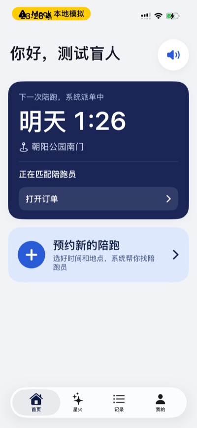
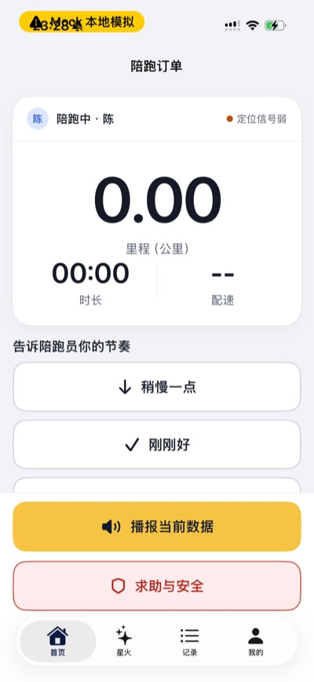
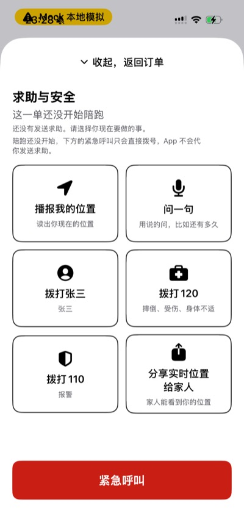
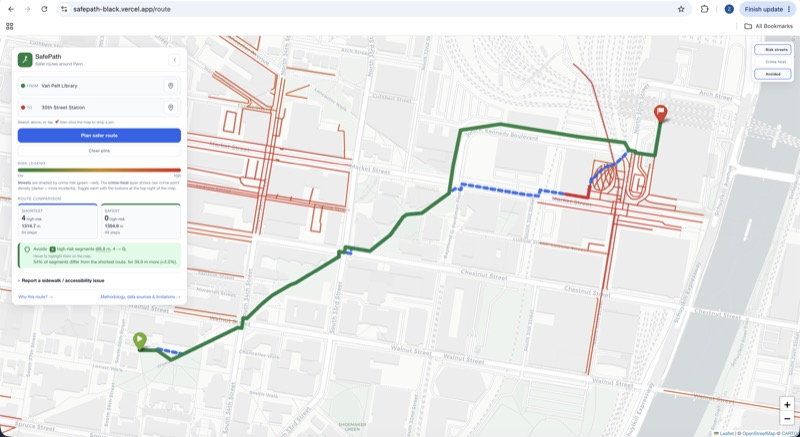

**English** · [中文](README.zh-CN.md)

# Jayden

I build software for real problems and real users. What I enjoy most is owning a system
end to end — the app in someone's hand, the server behind it, the data underneath — and then
checking that it actually works for the person using it. I'm drawn to information systems
and to computing where software meets hardware.

| Project | The problem | What I did | Where it is now |
|---|---|---|---|
| [AidRun · 助盲跑](#aidrun--助盲跑) | Blind runners need a sighted guide, but have no reliable way to book one | Built the iOS app, the backend and the Android app | Backend running in the cloud; app in pre-release testing |
| [Minecraft planning study](#llm-agents-that-plan-in-minecraft) | LLM agents break down on long, multi-step plans | First author | Poster at the NEmo workshop, NeurIPS 2026 |
| [SafePath](#safepath) | Map apps find the shortest walk, not the safest one | Built it alone | [Live demo](https://safepath-black.vercel.app) |

---

## AidRun · 助盲跑

  
  
  
  

**The problem.** A blind runner can run outdoors with a sighted guide, usually linked by a
short tether. Finding a guide for a specific time and place depends on who you happen to know.
People who want to volunteer have no simple way to reach runners. And any booking tool has to
work for someone who cannot see the screen.

**What it does.** The runner books a time and place by voice or by form. The system matches
a nearby volunteer whose identity has been verified. Both then follow one shared flow: an intro
phone call before a first run together, departure, meeting up, the run, and a run record.
During the run the runner hears distance and pace, can tell the guide "a bit slower" or
"just right" with one tap, and has an SOS button that sends their live location.

**How it works.** An iOS app (SwiftUI) and an Android app (Jetpack Compose) talk to a
Spring Boot backend. REST handles bookings; WebSocket pushes new requests and live locations
in real time. The server owns a 12-state order machine, so both phones always agree on what
happens next. For voice booking, Apple's speech recognizer turns speech into text, an LLM (Qwen)
on the backend pulls out the time and place, and the app reads them back for confirmation.

**What was hard**

- *Designing for people who can't see the screen.* Every control has a spoken label for
  VoiceOver, touch targets are 64 pt (Apple's minimum is 44), and state changes are announced
  out loud. UI tests run Apple's accessibility audit on the main screens on a real iPhone.
- *An emergency button that never misleads.* SOS only sends with a fresh GPS fix. The app never
  says "your family has been notified", because the SMS goes out later and can still fail.
  Outside a run, the same button falls back to calling 120 or 110 and says plainly that
  the app has not sent anything.
- *Privacy when the screen talks.* VoiceOver speaks out loud in public. So a runner's phone
  number is shown masked to the volunteer, and the full number is never read aloud.
- *Keeping three apps in sync.* One OpenAPI spec in the backend is the single source of truth.
  The iOS network code is generated from it. CI fails if an app calls an endpoint that isn't in
  the spec, or if a backend change would break existing apps.

**Results** (April – October 2026)

| Part | Stack | My commits | Merged PRs | Automated tests |
|---|---|---|---|---|
| iOS app | Swift, SwiftUI, AMap, AVSpeech / Speech, ActivityKit | 533 of 611 | 285 | 1,884 |
| Backend | Java 17, Spring Boot 3.5, MySQL, Redis, WebSocket | 969 of 988 | 447 | 2,082 |
| Android app | Kotlin, Jetpack Compose, Retrofit | 93 of 98 | 88 | 3,458 |

The backend runs on Alibaba Cloud, and the
[privacy policy and user agreement](https://jayden23018.github.io/blindrun-legal/) are public.
The app is in pre-release testing on real devices and is not on the App Store yet.

**My role.** I wrote the backend from the first commit and ported the app to Android.
The iOS app began as a teammate's prototype; I took it over in July 2026.
Code: [iOS (public)](https://github.com/Jayden23018/blind-run-ios) · backend and Android are private.

---

## LLM agents that plan in Minecraft

**The problem.** LLMs are now used to plan actions for game characters and robots. They are
weak at long chains of prerequisites: to make one item you need another, which needs a third.
Minecraft is a good place to measure this, because every recipe is known and a plan can be
checked exactly.

**What we did.** We asked LLMs to write plans for a Minecraft agent and scored every plan with
a rule-based checker that walks it step by step over a virtual inventory. We compared 7 models
(from 8 billion to 671 billion parameters, where disclosed), with and without example plans
added to the prompt. We also built SAER, a method that picks the most relevant examples using
the game's recipe graph.

**Results** (from the accepted paper)

- For 5 of the 7 models, plans for two-step-chain tasks pass only 10–30% of the time without
  examples, against 45–95% for single-material tasks.
- Adding three examples of the same kind improves all five.
- Randomly chosen examples of the right kind recover most of the gain (+31 percentage points).
  Ranking them precisely adds a smaller +12 points, which our pre-planned statistical
  correction did not confirm.
- Models copy their examples word for word, mistakes included: one invalid command in the
  combat examples shows up in 71.5% of plans that saw it, and in none of 505 plans that didn't.
- Takeaway: giving the model a worked example matters more than picking the perfect one —
  and the examples must be checked, because their errors get copied.

**What was hard.** Our starting idea was that a smart example picker would let a small 8B model
match a much larger one. Clean data said no (28% vs 50%), so we rebuilt the paper around what
the data did support. Midway we found a one-line setup bug that had silently switched off three
of the picker's four scoring signals; we fixed it and re-ran the affected experiments. We fixed
the main metric and statistical tests (McNemar, with multiple-comparison correction) before
looking at results, and reported the results that went against our method.

**My role.** First author. I built the evaluation pipeline: cross-validation, the significance
tables, and a replication on an open-weight model.
Accepted as a poster at the NEmo workshop, NeurIPS 2026. Stack: JavaScript (Node.js, Mineflayer),
Python. Code is private.

---

## SafePath

**The problem.** Map apps optimize for distance. For a student walking home at night, the
shortest way can run through blocks with a long history of street crime. Broken sidewalks,
missing curb ramps and dark streets never show up in routing at all.

**What it does.** Pick a start and an end near Penn. SafePath draws the shortest route (blue)
and the safest route (green), marks the risky blocks the safe route avoided (red), and explains
in plain words why it chose that route. Anyone can report a sidewalk problem, and the next
route avoids that block.

**How it works.** I built a walking graph of the 3.5 km around campus from OpenStreetMap.
About 107,000 past crime reports from OpenDataPhilly are spread onto nearby streets (within
120 m, weighted by distance). Each street gets a risk score, and its cost becomes
`length × (1 + 1.5 × risk)`. Dijkstra's shortest-path algorithm runs twice — once on plain
length, once on this cost — and both routes are drawn.

**What was hard**

- Raw crime counts made short crosswalk segments look dangerous just for being short.
  Ranking risk by percentile fixed that.
- One incident counts toward every street within 120 m, so a total per route would count the
  same incident many times. The app lists the most common incident types instead of a number.
- A hosted demo can't keep user reports between restarts. I wrote that down, together with
  12 other limits, in the README — starting with "historical crime is not a prediction".

**My role.** Solo final project for a University of Pennsylvania summer program.
Python, Flask, Pandas, OpenStreetMap, Leaflet.
[Code](https://github.com/Jayden23018/safepath) · [Live demo](https://safepath-black.vercel.app)

---

## Smaller projects

- **Physics demo** — interactive double-pendulum chaos simulation with an AI chat tutor.
  React, TypeScript, Vite.
- **Chinese slide generator** (private) — generic slide tools break Chinese typesetting, so this
  makes single-file HTML decks that work offline, with embedded subset fonts and vector PDF export.
- **Personal site** — Astro, MDX, GSAP; my résumé is typeset in Typst.

## Tools I use day to day

Swift / SwiftUI · Java / Spring Boot · Kotlin / Compose · Python / PyTorch · TypeScript / React ·
MySQL · Redis · Git & GitHub Actions

## Contact

zw6963470@gmail.com
