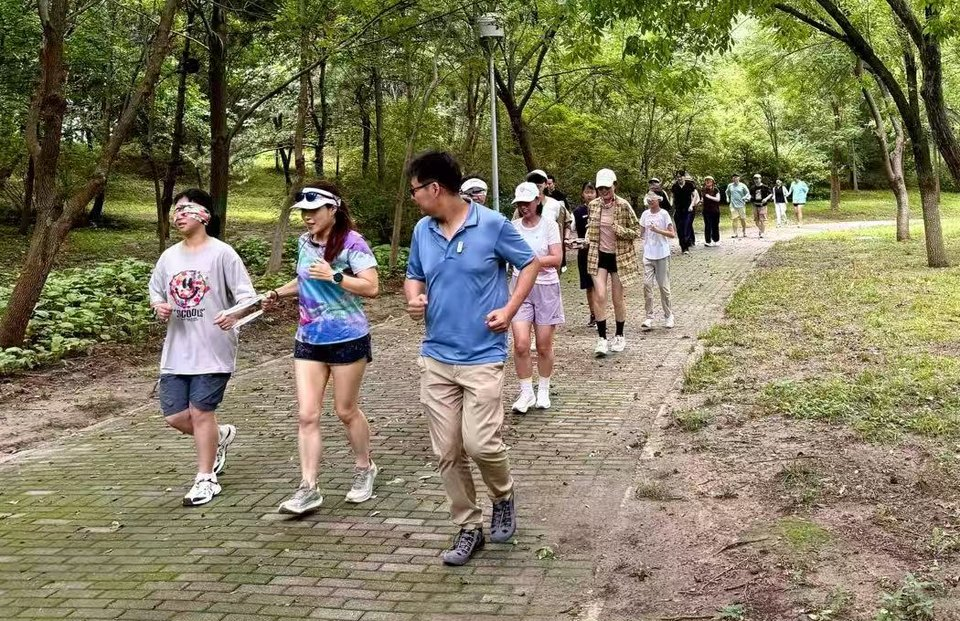
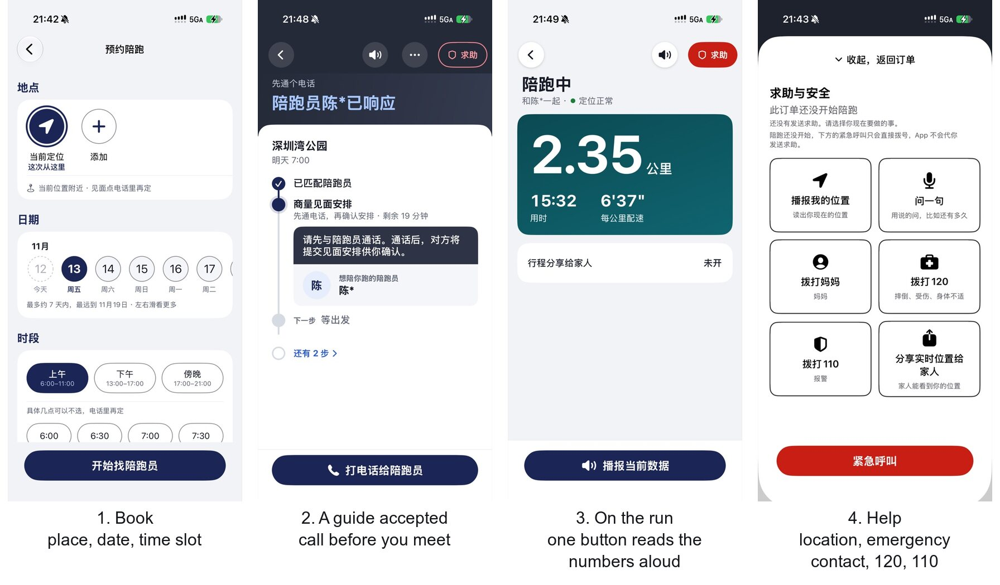
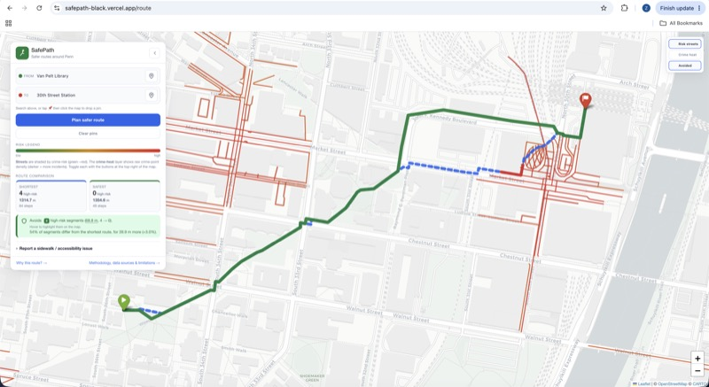

**English** · [中文](README.zh-CN.md)

# Jayden Wang

I'm Jayden, a high school student at SCIE in Shenzhen. I build apps and do AI research.

[Portfolio: jaydenw.me](https://www.jaydenw.me) · [Résumé (PDF)](https://www.jaydenw.me/Jayden_Wang_Resume.pdf) · zw6963470@gmail.com

| Project | Results | Tech |
|---|---|---|
| [GuideRun · 助盲跑](#guiderun--助盲跑) An app that matches blind runners with volunteer guides | Internal testing is done, with 30+ blind runners and 30+ guides. The iOS app is in App Store review. Partner: Shenzhen Association of the Blind | Java 17, Spring Boot, MySQL, Redis, WebSocket; Swift / SwiftUI; Kotlin / Compose. OpenAPI contract testing |
| [AI planning paper](#ai-agents-that-plan-in-minecraft) Why LLM agents fail at multi-step plans | First author. Accepted at the NEmo workshop, NeurIPS 2026. In review at AAAI-27 | Example retrieval (SAER), ablation, paired McNemar tests with Bonferroni correction; Node.js, Mineflayer |
| [Contrast-free CT](#contrast-free-ct) Contrast CT generated from plain CT | Ongoing research collaboration with West China Hospital, Sichuan University, on 49 lung-cancer patients | GAN, then diffusion; NCC registration; patient-level five-fold cross-validation; membership-inference audit; PyTorch, MONAI |
| [SafePath](#safepath) The shortest and the safest walking route on one map | [Live](https://safepath-black.vercel.app). Final project at Penn's ESAP. It earned college credit and a certificate | Dijkstra on a weighted graph, percentile-rank normalization; Flask, OSMnx / NetworkX, GeoPandas, SQLite |

---

## GuideRun · 助盲跑

I run. At a road race in Shenzhen I met blind runners doing the same, and I became a volunteer
guide. Twice a month I run tethered to a blind runner. On those runs I heard how rarely they
get to run. Their clubs had runners and had volunteers, but finding a guide still took phone
calls and group chats. So I offered to build the app. I started in October 2025. It was first
called BlindRun.

A clip from the demo. The full film is 92 seconds, and this is the English edition of the one I showed at COSCon'26. [Watch all of it](assets/guiderun-demo.mp4).

### What testing with runners changed

I built the first version like any booking app: a form with exact start and end points. Only
when I closed my eyes and tried to book a run did I see how slow a form is without the screen,
and how easy it is to get wrong. So I added booking by voice.

But closing my eyes could only find the problems I could imagine. Since May 2026, 30+ blind
runners and 30+ guides have tested the app. On her first booking, one runner got stuck in the
form. The first voice version misheard a request and booked anyway, without saying what it had
heard. The testers' top complaint was one I had never thought of: at the meeting spot, runner
and guide couldn't find each other.

So I rebuilt booking around a phone call. A runner now picks only three things: a place, a day
and a time of day. Then runner and guide talk over a privacy-masked number and settle the rest:
where to meet, where to finish, the route and the pace. They also agree on whether a guide dog
is coming, whether the guide runs ahead on the left or on the right, and which tether they will
use and how long it is. The guide fills in the form, and the runner only confirms it.

The call does a second job. Two strangers who are about to run tethered together find out
whether they get along, and either can walk away. A pair whose call went badly is never matched
again. A runner can keep a guide as a regular partner, and that guide then gets 15 points on
top of the 100-point match score. It makes the partner more likely to be asked, not certain: a
good guide nearby still beats a partner across the city.

### Matching

An unverified guide is removed before scoring begins. The rest are scored out of 100: distance
40, schedule overlap 25, past rating 20, pace match 10, acceptance rate 5. Pace was the one I
underestimated. A guide who is close, free and well rated is still the wrong guide if they
can't hold the runner's pace for 10 km.

Three designs I threw out:

- How many guides to ask. I ruled out a broadcast to every nearby guide from the start, because the fastest thumb would beat the best match and two guides could both commit. My first design offered a run to one guide at a time, best match first, with 30 seconds to answer. It didn't survive the way people book. Runs get booked a day ahead, and a guide with a locked phone never saw an invitation, because invitations weren't sent as push notifications yet. A 30-second countdown would also push guides to say yes and cancel later. The answer window had to grow to as long as an hour, and at an hour each, asking ten guides takes ten hours. Since October 2026 the system invites the three best-matched guides together. The first to accept gets the run, and the other two invitations are withdrawn. If none of them takes it, the next three are invited.
- Two guides, one run. With three guides invited, two accepts can land milliseconds apart. My first guard was a version column with a loop that retried a rejected write three times. A test showed the loop had never once worked: a retry inside one transaction rereads the same stale copy of the row. Now each accept takes a row lock on the order, and the second guide is told the run is taken. The version column stays as a last check.
- Emergencies. My first version notified the guide, waited 30 seconds for a confirmation, and only then reached the runner's emergency contacts. A runner who had actually fallen would have a family that heard nothing for those 30 seconds. Now the text to the emergency contacts waits for no one, and the guide is told in parallel. A runner's own SOS has a 3-second countdown to cancel a mistaken press, and a guide's goes out at once. If a text fails, the system tries the next contact, alerts the support desk and tells the runner not to wait.

### More engineering notes

- My first rate limiter did "increment, then expire" as two Redis commands. If the service died between them, the counter had no expiry, and that user stayed rate-limited for good, with nothing in the logs to say why. One Lua script now sets both together or not at all.
- SOS messages have their own thread pool: 8 threads and a queue 1,000 deep. They used to share one pool with dispatch and points, behind up to 200 queued tasks. A slow SMS provider can take 15 seconds per message, so an SOS text could have waited minutes.
- The app never says "your family has been notified", because the SMS goes out later and can still fail.
- A runner's phone number is shown masked, and the screen reader does not read it out.
- The runner's key buttons are at least 64 pt high, and Apple recommends 44. The app has 421 labels for VoiceOver to read aloud, and 20 automated audits for missing labels, cut-off text, contrast and text size.
- New guides are certified online. A person checks their identity papers, and they take online courses with a quiz that counts only if every answer is right. A guide can be invited only once both are done.
- The app's networking code is written by hand. The build also generates a client from the backend's OpenAPI spec and never uses it at runtime. If regenerating that client produces a diff, the app and the backend no longer agree, and CI fails.

<table>
<tr><td><b>Status</b></td><td>30+ blind runners and 30+ volunteer guides have finished internal testing. The iOS app has been submitted for App Store review</td></tr>
<tr><td><b>Partner</b></td><td>Shenzhen Association of the Blind</td></tr>
<tr><td><b>My role</b></td><td>I built the entire backend alone: matching, real-time location, identity verification and concurrency control. A teammate started the iOS app. I took it over in July 2026 and wrote most of what shipped since, including SOS, live location of the other runner, voice input and the accessibility work. I am porting the app to Android from the iOS version, and that port is not finished</td></tr>
<tr><td><b>Tests</b></td><td>2,596 automated tests and 137 API endpoints on the backend, and 1,200 concurrent WebSocket connections verified. The iOS UI tests run Apple's accessibility audit on the main screens</td></tr>
<tr><td><b>Stack</b></td><td>Backend in Java 17, Spring Boot, MySQL, Redis and WebSocket. <a href="https://github.com/Jayden23018/guiderun-ios">iOS</a> in Swift and SwiftUI. Android in Kotlin and Compose. I work with Claude Code as a coding assistant, and I read every change before it merges</td></tr>
<tr><td><b>Read more</b></td><td><a href="https://www.jaydenw.me/work/guiderun">Case study</a> · <a href="https://jayden23018.github.io/blindrun-legal/">Privacy policy and user agreement</a>. The backend and Android code are private</td></tr>
</table>

---

## AI agents that plan in Minecraft

I wanted an assistant to spare me the boring parts of Minecraft, like collecting the same
resources again and again. A small model on my own computer kept losing its plan halfway:
around step three or four it asked for an item it had never made. I wanted to know why.

I did not fine-tune the model. The game keeps shipping new content, and retrained weights are
out of date the day it does. I changed what the model is told instead, by putting worked
examples into the prompt.

What I built:

- SAER, a scorer that picks the examples. It picks by the materials the task needs, not by which text looks most alike.
- A pool of 55 worked examples (25 crafting, 21 collecting, 9 combat). Each is a JSON record with the same fields: the exact bot commands for every step, what must already be true, and what the step makes.
- The evaluation: 60 held-out tasks, 7 models, three runs per task, with and without examples. A rule-based checker walks every plan step by step. The 13 comparisons were fixed before any result was read.

What it showed:

- Tasks that need a two-step chain of materials passed only 10–30% of the time without examples. Single-material tasks passed 45–95%.
- Four of the five main models improved significantly. The largest gain was Qwen2.5-Max, from 32% to 82%. The smallest model, at 8B, went from 23% to 43% and did not pass the corrected test.
- On Qwen2.5-Max the gain was 50 points. Three random examples of the right kind already gave 31 of them. SAER's picks scored 12 points above plain keyword search, and our planned statistical test did not confirm that step.
- Models copy mistakes from their examples. One invalid command came from the examples: 726 of the 1,016 plans written with examples (71.5%) copied it, and none of the 505 plans written without examples did.

I had expected a smart example picker to let a small model match a large one. It did not: the 8B model
with SAER reached 43%, and DeepSeek-V3 with no examples reached 55%. So we rebuilt the paper
around what the data did support. Midway I found that the evaluation script never called one
function, so the ingredient-overlap score had always been 0. I fixed it and re-ran the
experiments that used SAER.

<table>
<tr><td><b>Status</b></td><td>Accepted at the NEmo workshop, NeurIPS 2026. In review at AAAI-27</td></tr>
<tr><td><b>My role</b></td><td>First author, advised by Dr. Li Ning (Stellaris AI). I designed SAER and its scoring, built the evaluation, and ran the study across the models. Ziming Dai built the part where the bots work together</td></tr>
<tr><td><b>Stack</b></td><td>JavaScript / Node.js, Mineflayer, OpenAI SDK (multi-provider)</td></tr>
<tr><td><b>Read more</b></td><td><a href="https://github.com/Jayden23018/existence-before-relevance">Code and data</a> · <a href="https://openreview.net/forum?id=wDcm2pSp4z">Paper on OpenReview</a> · <a href="https://www.jaydenw.me/work/llm-planning">Case study</a></td></tr>
</table>

---

## Contrast-free CT

Contrast-enhanced CT normally requires a dye injection that some patients cannot safely
receive, because of kidney disease or an allergy. With scans from West China Hospital, I tried to generate these images from plain
scans instead. It is research only, not for diagnosis.

Most papers I read used structural similarity (SSIM) to judge such a model, so I did the same,
and the score climbed to 0.88. Then I opened a few generated images next to the real ones, and
the anatomy didn't match. I found two problems.

The pairs were wrong. A plain scan and a contrast scan are two separate acquisitions, and they
start at different positions along the body. My first pipeline paired them by slice number,
which was off by an average of 37 slices, roughly 185 mm.

The metric was wrong too. A plain scan and a contrast scan already look alike in structure, so
a high SSIM could only confirm that. It could not say whether the highlights were in the right
place.

So I did three things:

- I wrote an alignment algorithm. It resamples both scans to one grid, slides one along the body to find the best correlation, and drops pairs below 0.9. The last step is a check by eye. I kept that step manual on purpose, because the numbers had already misled me once.
- I wrote a new measure that checks whether the highlights are in the right place.
- I split training, validation and test sets by patient, in five folds. One patient's slices never sit on both sides, the test set is used once, and each of the 49 patients is tested once.

On patients the model had never seen, the correlation between generated and real contrast was
r = 0.31 for the chest and 0.18 for the abdomen. My target was 0.5. No patient reached it. The
confidence interval is ±0.02 wide, so this is not a case of too little data. Part of the cause
is known: in the real scans the regions that take up the dye are 4.5 times brighter than the
scan overall, and in the model's scans only 2.0 times. The model learned to brighten the whole
image roughly evenly.

All 49 patients came from one hospital, so I still do not know how it would do elsewhere.

More notes:

- An early chest score was r = 0.61. Then, for the same model and the same patient, sampling 85 slices and not 61 moved it to 0.40. So I do not use the 0.61.
- I built a baseline with perfect anatomy and the average brightness of all patients. It reaches only r ≈ 0.38 on the chest (one fold, 10 patients). So my 0.5 target may have been set too high.
- I also tested whether the model memorized its training patients. The pixel-level measures gave AUC 0.70 to 0.80, which leans toward memorization. The feature-level ones say nothing either way. So the project has a rule against writing "no evidence of memorization".
- Data that leaves the hospital is pseudonymized and date-shifted.

<table>
<tr><td><b>Status</b></td><td>Ongoing research collaboration with West China Hospital, Sichuan University. No paper yet. A later version scores higher on 20 test slices and has not yet repeated the five-fold test</td></tr>
<tr><td><b>My role</b></td><td>The hospital provided the scans and the clinical question. The research and all of the code are mine. I started in August 2025 with a GAN and later moved to a diffusion model</td></tr>
<tr><td><b>Code</b></td><td>Private, because of patient data. Python, PyTorch, MONAI</td></tr>
<tr><td><b>Read more</b></td><td><a href="https://www.jaydenw.me/work/virtual-cect">Case study</a></td></tr>
</table>

---

## SafePath

In summer 2026 I was in a foreign city on my own for the first time. I picked my walking routes
by instinct, and I had no way to tell whether the instinct was any good. Map apps answer
"shortest". I wanted one that also answers "safest".

Pick a start and an end near Penn. SafePath draws both routes on one map and tells you what the
safer one costs. On the walk from Penn Park to Mill Creek, the shortest route crosses 10
high-risk blocks. The safe route crosses none and is 107 m longer.

How it works:

- The data is the city of Philadelphia's 2024 to 2026 incident files. I dropped duplicates and rows with no location and kept the 3.5 km box around Penn: 397,464 rows became 106,881 incidents. The street network comes from OpenStreetMap.
- Every street gets a risk score. Dijkstra's algorithm runs twice, once on distance and once on distance weighted by risk.

The routing was the easy part. Checking whether it worked was harder.

- My first score divided each street's crime weight by its length, which made the most dangerous places in the city three-meter crosswalk stubs. Ranking streets by percentile fixed that.
- My first check added up the risk along each route. The totals differed by 1 to 2%, which showed nothing. My second check measured how much longer the safe route is, and it failed the other way: a route whose blocks were 92% different read as "the same route" because it was only 3.4% longer. I replaced both with things a person can picture: the number of high-risk blocks, the meters of high-risk street, and how much of the two routes is different.
- The popup once read "Fraud (1850)" over ten blocks. Each incident is attached to every street near it, about 112 streets on average, so adding the counts along a route counted the same incident many times. It now ranks the incident types, shows no count, and says why.

The score is built from incidents reported to the police, which is not the same as all crime.
The red shading shows where incidents were recorded. It says nothing about the people who live
on those streets.

<table>
<tr><td><b>Status</b></td><td>Live. Anyone can open the <a href="https://safepath-black.vercel.app">demo</a> and plan a walk. Thirteen self-checks run inside the code as plain asserts, with no test framework</td></tr>
<tr><td><b>My role</b></td><td>Solo final project for the computer course at Penn's Engineering Summer Academy (ESAP). It earned college credit and a certificate</td></tr>
<tr><td><b>Stack</b></td><td>Python, Flask, pandas / GeoPandas, NetworkX / OSMnx, SQLite, Folium</td></tr>
<tr><td><b>Read more</b></td><td><a href="https://github.com/Jayden23018/safepath">Code</a> · <a href="https://www.jaydenw.me/work/safepath">Case study</a></td></tr>
</table>

---

## Honors

- USACO Gold, 2026. USA Computing Olympiad, Gold division.
- AIME qualifier, 2025. American Invitational Mathematics Examination.
- AMC 12, top 5% nationally, 2024.
- Silver, Senior Physics Challenge, 2025. Run by the British Physics Olympiad.

## Talks

- COSCon'26, the 11th China Open Source Conference, Hangzhou, November 2026. I gave a talk of about 30 minutes on GuideRun at the Youth Open Source Forum. I also sat on the main-forum roundtable on the next generation of open-source talent ([announcement, in Chinese](https://www.sohu.com/a/1100311889_115128)).
- COSCon'25, the 10th China Open Source Conference, Beijing, December 2025. I was invited to the Youth Open Source Forum with Ziming Dai, and presented the method from my paper. [Talk page](https://www.jaydenw.me/work/coscon25)

## Also

- A double-pendulum simulation with an AI tutor (React, TypeScript).
- [jaydenw.me](https://www.jaydenw.me), my portfolio and personal site (Astro).
- Away from the screen: I guide blind runners twice a month, and in November 2026 I passed stage one of four of guide training. Nationally certified Level-2 athlete in table tennis, amateur 3-dan in Go, and I take photos, some of them from a drone.
