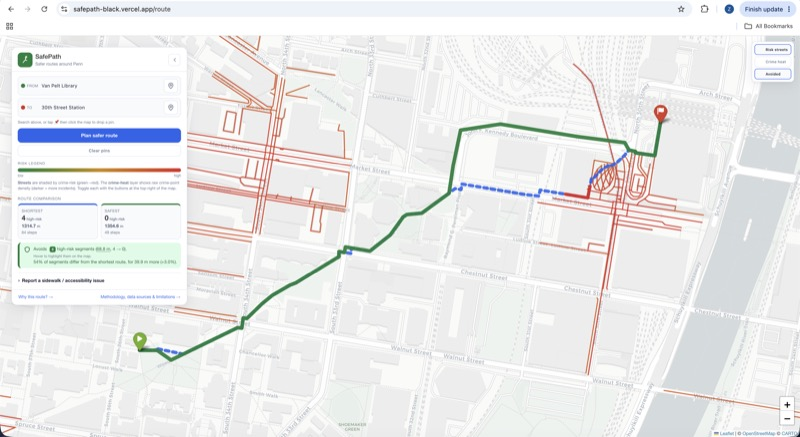

[English](README.md) · **中文**

# Jayden Wang

我是 Jayden，深圳 SCIE 的高中生。我做了一个帮盲人跑者约陪跑员的 App，也是一篇论文的第一作者，论文研究 AI 智能体为什么做不好多步计划。我也参加算法和数学竞赛：USACO 金级、AIME 晋级。

[作品集：jaydenw.me](https://www.jaydenw.me) · [简历（PDF）](https://www.jaydenw.me/Jayden_Wang_Resume.pdf) · zw6963470@gmail.com

| 项目和我做的部分 | 为什么做，现在怎样 |
|---|---|
| [助盲跑 GuideRun](#助盲跑-guiderun) 后端由我一个人设计和搭建，从队友手里接手 iOS，再移植到 Android | 我每月两次给盲人跑者陪跑，听他们说很少有机会跑步。 **现状：**30+ 盲人跑者和 30+ 陪跑员完成内测，iOS 版在 App Store 审核中 |
| [AI 规划论文](#ai-智能体在-minecraft-里做规划) 第一作者 | 想要一个 Minecraft 助手，它却总是把计划弄丢。 **现状：**已被 NeurIPS 2026 的一个 workshop 接受，AAAI-27 审稿中 |
| [不打造影剂的增强 CT](#不打造影剂的增强-ct) 研究和代码都是我做的，华西医院提供影像 | 增强 CT 要打造影剂，有些病人不能安全使用。 **现状：**进行中。模型在没见过的病人上没有达标 |
| [SafePath](#safepath) 一个人做完 | 第一次一个人待在国外的城市，走哪条路全凭感觉。 **现状：**[在线演示](https://safepath-black.vercel.app)，拿到了大学学分 |

---

## 助盲跑 GuideRun

我自己跑步。在深圳的一场路跑赛上，我遇到了同样在跑的盲人跑者，后来成了陪跑志愿者，每月两次牵着陪跑绳和他们一起跑。
跑的时候我听他们说，平时很少有机会跑步。跑团里有跑者，也有志愿者，可是约一次陪跑还得靠打电话和发群消息。
于是我提出来做这个 App。2025 年 10 月开始做，英文名最早叫 BlindRun。

这是我在 COSCon'26 上放的 92 秒演示里的一段，英文字幕是后加的。[看完整视频](assets/guiderun-demo.mp4)。

一开始有好几处我都想错了，是测试的人让我改过来的。抢单模式会让住得偏的跑者一直等不到人，我换成了系统派单。
预约用表单，当时觉得理所当然。直到我闭上眼睛自己试了一次，才知道看不见屏幕时填一张表有多难，也真有一位盲人测试者卡在了表单里。
第一版语音预约听错了跑者的话，却没有念出它听到了什么，就直接下了单。现在跑者只选三样，剩下的在电话里定。
测试者提得最多的问题是我完全没想到的：到了约好的地方，两个人找不到对方。所以每次跑步前都要先通一个电话。

有三个设计是我自己推翻的：

- 匹配。最初的设计是一次只问一位陪跑员，从最合适的问起，30 秒内答复。我没用「广播给附近所有陪跑员」，因为那样手快的会赢过最合适的。但它不符合大家实际约跑的方式：陪跑是提前一天约的，答复时间得放宽到最长一小时，而一人一小时，问十个人就要十小时。现在系统一次邀请最合适的三位。
- 两位陪跑员抢到同一单。同时邀请三位，两个「接单」可能只差几毫秒。我第一版用的是版本号字段，写入被拒就重试三次。一个测试表明这个重试从来没有生效过：同一个事务里重试，读到的还是那份旧数据。现在每次接单先给订单加行锁，后到的陪跑员会被告知这一单已经有人接了。
- 紧急求助。第一版是先通知陪跑员，等 30 秒确认，然后才联系跑者的紧急联系人。如果跑者真的摔倒了，家人在这 30 秒里什么都不知道。现在发给紧急联系人的短信不等任何人，同时通知陪跑员。

更多工程上的事

- 每个控件都有 VoiceOver 的语音标签。触控区域是 64 pt，Apple 的下限是 44。
- 只有拿到新的定位才会发出求助。App 从不说「已通知家人」，因为短信是之后才发的，还可能失败。
- 跑者的手机号是打码显示的，因为 VoiceOver 会在公共场合把屏幕念出来。
- 求助短信有自己单独的线程池，短信服务商再慢，它也不用排在普通任务后面。

<table>
<tr><td><b>现状</b></td><td>30+ 盲人跑者和 30+ 陪跑志愿者完成了内测。iOS 版已提交 App Store 审核</td></tr>
<tr><td><b>合作方</b></td><td>深圳市盲人协会</td></tr>
<tr><td><b>我的角色</b></td><td>后端从第一次提交起就由我一个人设计和搭建。iOS 版由队友起头，我 2026 年 7 月接手。Android 版是我移植的</td></tr>
<tr><td><b>怎么保证它是对的</b></td><td>后端有 2,596 个自动测试。三端共用一份接口规范，App 调用了规范里没有的接口，CI 就不通过。界面测试会在主要页面上跑 Apple 的无障碍审计</td></tr>
<tr><td><b>技术栈</b></td><td>后端 Java、Spring Boot、MySQL、Redis。<a href="https://github.com/Jayden23018/guiderun-ios">iOS</a> 用 Swift 和 SwiftUI。Android 用 Kotlin 和 Compose。我用 Claude Code 做编程助手</td></tr>
<tr><td><b>更多</b></td><td><a href="https://www.jaydenw.me/work/blindrun">完整案例（英文）</a> · <a href="https://jayden23018.github.io/blindrun-legal/">隐私政策与用户协议</a>。后端和 Android 代码是私有的</td></tr>
</table>

---

## AI 智能体在 Minecraft 里做规划

我想要一个助手，替我做 Minecraft 里无聊的部分，比如一遍遍采集同样的资源。跑在我自己电脑上的小模型，做到一半总会把计划弄丢。我想知道为什么。

我们让 7 个语言模型给 Minecraft 智能体写计划，再用一个按规则走的检查器一步步核对每份计划。提示词里有示例和没有示例，两种情况都测了。

- 需要两步材料链的任务，不给示例时只有 10–30% 能通过。只要一种材料的任务有 45–95%。
- 只要给的是同一类示例，大部分差距就补回来了（+31 个百分点）。挑出最合适的那个示例，多出来的提升更小（+12），而且没通过我们事先定好的统计检验。
- 模型会照抄示例里的错。有一条无效指令，看过它的计划里 71.5% 都出现了；没看过它的 505 份计划里一次也没有。

我原本以为，一个聪明的示例挑选器能让小模型追上大模型。数据说不行（28% 对 50%），我们就按数据撑得住的结论把论文重写了。
中途还发现一行配置写错了，挑选器的四个信号里有三个一直没起作用。我们改好后重跑了那几组实验。

<table>
<tr><td><b>现状</b></td><td>已被 NeurIPS 2026 的 NEmo workshop 接受。AAAI-27 审稿中</td></tr>
<tr><td><b>我的角色</b></td><td>第一作者，导师是 Dr. Li Ning（Stellaris AI）。方法是我设计的，评测是我搭的。多个机器人协作的部分由 Ziming Dai 完成</td></tr>
<tr><td><b>更多</b></td><td><a href="https://github.com/Jayden23018/existence-before-relevance">代码与数据</a> · <a href="https://www.jaydenw.me/work/llm-planning">完整案例（英文）</a></td></tr>
</table>

---

## 不打造影剂的增强 CT

增强 CT 一般要注射造影剂，有些病人不能安全使用。我用华西医院的影像，试着让模型从平扫 CT 直接生成增强图像，给读片的医生做参考。

我读到的论文大多用结构相似度来评价这类模型，我也照着用了。有一次实验分数很高，可我打开生成的图一看，亮起来的地方全不对。
平扫和增强在整体结构上本来就很像，这个指标只能证明这一点。我重新定了一个标准，看亮起来的位置对不对，然后一位病人一位病人地测。

在模型没见过的病人上，生成图像和真实增强图像的相关系数，胸部是 r = 0.31，腹部是 0.18。我定的目标是 0.5，没有一位病人达到。
49 位病人都来自同一家医院，所以换一家医院会怎样，我还不知道。

工程上的几件事

- 早期有过 r = 0.61，那是 5 位病人的结果。只换了抽哪些切片，同一个模型就从 0.61 掉到 0.40。现在每个指标我都记版本。
- 两次扫描不是同一时刻拍的，对不齐。一个解剖结构完全正确、亮度取平均的参照，在胸部也只有 r ≈ 0.38，所以差距里有一部分是没对齐，不是模型。
- 离开医院那台机器的数据都做了假名化和日期偏移。不公开任何病人影像。

<table>
<tr><td><b>现状</b></td><td>与四川大学华西医院的合作研究，进行中。还没有论文</td></tr>
<tr><td><b>我的角色</b></td><td>医院提供影像和临床问题。研究和全部代码是我做的。2025 年 8 月开始，先用 GAN，后来改用扩散模型</td></tr>
<tr><td><b>代码</b></td><td>因为涉及病人数据，保持私有。Python、PyTorch、MONAI</td></tr>
<tr><td><b>更多</b></td><td><a href="https://www.jaydenw.me/work/virtual-cect">完整案例（英文）</a></td></tr>
</table>

---

## SafePath

2026 年夏天，我第一次一个人待在国外的城市。走哪条路全凭感觉，也没办法知道这感觉准不准。
地图软件回答的是「最短」，我想要一个也能回答「最安全」的。

在宾大附近选起点和终点，SafePath 把两条路线画在同一张地图上，并告诉你走更安全的那条要多付出什么。
从 Penn Park 到 Mill Creek 这一段，最短路线经过 10 个高风险街区。安全路线一个也不经过，多走 107 米。

怎么实现的

- 路网来自 OpenStreetMap。风险分数来自费城市政府记录的 106,881 起事件。
- Dijkstra 算法跑两次，一次按距离，一次按风险加权后的距离。
- 直接用案件数量，会让很短的人行横道只因为短就显得危险。改成按百分位排名后好了。
- README 里列了 13 条局限，第一条是「历史犯罪记录不是预测」。

<table>
<tr><td><b>现状</b></td><td>已上线。谁都能打开<a href="https://safepath-black.vercel.app">演示</a>规划一段路</td></tr>
<tr><td><b>我的角色</b></td><td>宾大工程暑期学院（ESAP）的结业项目，一个人完成。拿到了大学学分和证书</td></tr>
<tr><td><b>更多</b></td><td><a href="https://github.com/Jayden23018/safepath">代码</a> · <a href="https://www.jaydenw.me/work/safepath">完整案例（英文）</a></td></tr>
</table>

---

## 奖项

- USACO 金级，2026。美国计算机奥林匹克，Gold 组。
- AIME 晋级，2025。美国数学邀请赛，只邀请 AMC 成绩约前 5% 的学生。
- AMC 12 全国前 5%，2024。
- Senior Physics Challenge 银奖，2025。由英国物理奥林匹克（BPhO）主办。

## 演讲

- COSCon'26，第十一届中国开源年会，杭州，2026 年 11 月。我在青少年开源论坛讲了大约 30 分钟，介绍助盲跑；还作为嘉宾参加了主论坛「下一代开源人才」圆桌（[官方预告](https://www.sohu.com/a/1100311889_115128)）。
- COSCon'25，第十届中国开源年会，北京。我受邀在青少年开源论坛和 Ziming Dai 合讲，我讲的是论文里的方法。[演讲页（英文）](https://www.jaydenw.me/work/coscon25)

## 其他

- [物理演示](https://github.com/Jayden23018/Physic-demo)，一个可以上手玩的双摆模拟，带一个 AI 答疑助手。React 和 TypeScript。
- [jaydenw.me](https://www.jaydenw.me)，我的作品集网站，用 Astro 手写的。
