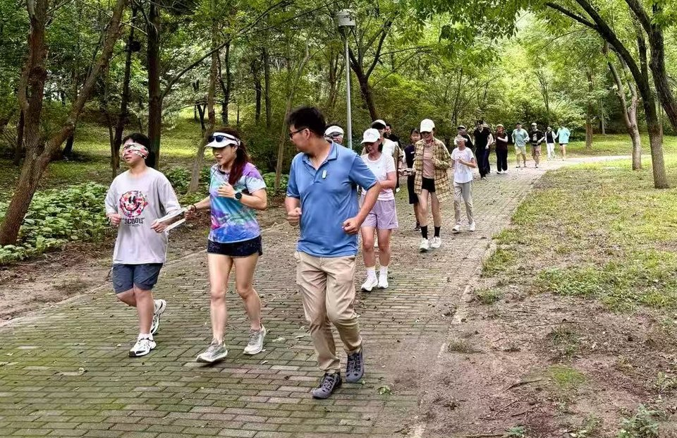
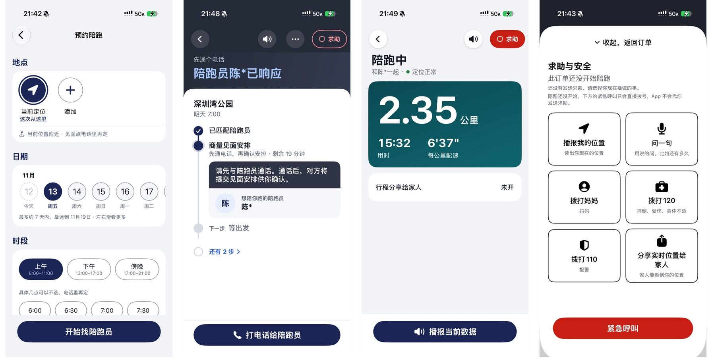

[English](README.md) · **中文**

# Jayden Wang

我是 Jayden，在深圳 SCIE 读高中，做应用，也做 AI 研究。

[作品集 jaydenw.me](https://www.jaydenw.me) · [简历 PDF](https://www.jaydenw.me/Jayden_Wang_Resume.pdf) · zw6963470@gmail.com

| 项目 | 成果 | 技术 |
|---|---|---|
| [助盲跑 GuideRun](#助盲跑-guiderun) 帮盲人跑者约陪跑员的 App | 30 多位盲人跑者和 30 多位陪跑员参加的内测已结束，iOS 版在 App Store 审核中。合作方是深圳市盲人协会 | Java 17、Spring Boot、MySQL、Redis、WebSocket；Swift / SwiftUI；Kotlin / Compose。OpenAPI 契约测试 |
| [AI 规划论文](#论文ai-agent-在-minecraft-里做规划) LLM agent 为什么做不好多步规划 | 第一作者。NeurIPS 2026 NEmo workshop 录用，AAAI-27 在审 | 示例检索（SAER）、消融实验、McNemar 配对检验 + Bonferroni 校正；Node.js、Mineflayer |
| [不打造影剂的增强 CT](#不打造影剂的增强-ct) 从平扫 CT 生成增强 CT | 和四川大学华西医院的合作研究，49 例肺癌病人，进行中 | GAN → 扩散模型、NCC 配准、按病人划分的五折交叉验证、成员推断审计；PyTorch、MONAI |
| [SafePath](#safepath) 同时给出最短和最安全的步行路线 | [已上线](https://safepath-black.vercel.app)。宾大 ESAP 结业项目，拿到大学学分和证书 | 加权图上的 Dijkstra、百分位归一化；Flask、OSMnx / NetworkX、GeoPandas、SQLite |

---

## 助盲跑 GuideRun

我平时跑步，在深圳的一场路跑赛上遇到了盲人跑者，后来就去当陪跑员，每个月两次，用陪跑绳带他们跑。路上听他们说，平时很难出来跑一次。跑团里跑者和志愿者都有，但约一次陪跑要打电话、在群里一个个问。跑团想要一个约陪跑的 App，于是我说我可以做，然后从 2025 年 10 月开始打磨。

演示视频的片段，[完整版](assets/guiderun-demo.mp4) 92 秒。

### 内测之后改了什么

第一版我照着普通的预约 App 做，一张表单，起点终点都要填具体位置。后来我闭着眼睛自己约了一次，填表又慢又容易错，就加了语音预约。

2026 年 5 月开始内测，冒出很多我自己闭着眼睛试不出来的问题。表单当时还留着，有位跑者第一次约跑就卡在了里面。第一版语音预约听错了，也没把听到的内容念一遍让人确认，就直接下了单。大家抱怨最多的是到了集合点两个人找不到对方，这个我之前没想到。

所以现在约跑要先通一次电话。跑者只选地点、日期、时段三样，接着两个人用隐私号码通话（互相看不到真实手机号），商量在哪见面、跑到哪、走哪条路、什么配速。带不带导盲犬、陪跑员在左前方还是右前方、用哪种陪跑绳和多长，也在电话里说好。商量完由陪跑员填进 App，跑者只需要点确认。

电话也是让两个人先聊聊合不合得来，毕竟是两个陌生人要牵着一根绳子跑，谁觉得不合适都可以不跑。通话不顺利的两个人，系统以后不会再配到一起。跑得来的可以结成固定搭档。

### 派单

没通过认证的陪跑员不会被派单。其他人按五项打分，满分 100：距离 40，时间合不合适 25，以往评价 20，配速 10，接单率 5。配速也要算，因为一个陪跑员离得近、有空、评价好，但跟不上跑者的配速，还是不合适。

固定搭档在 100 分的匹配分之外再加 15 分。但距离就占 40 分，离得远的搭档还是会排在附近的陪跑员后面。

### 重做过的地方

最早我是一次只问一位陪跑员，从分数最高的问起，每人要在 30 秒内答复。没做抢单，是因为抢单只看谁手快，而且两个人可能都以为自己接到了。但一次问一位也不行。陪跑一般提前一天约，当时邀请还不会发推送，陪跑员手机锁着屏就看不到。30 秒倒计时还会逼人先答应、之后再取消。答复时间于是放宽到最长一小时，可这样一位一位问，问十个人就要十小时。2026 年 10 月改成一次邀请分数最高的三位，谁先接就是谁，另外两个邀请马上撤回。三位都没接，再问后面三位。

一次邀请三位，就有并发接单的问题，两个请求可能只差几毫秒。我最早用乐观锁：订单表加 version 字段，更新失败重试三次。后来有个测试测出来，这个重试一次都没成功过，因为重试在同一个事务里，读到的还是同一份快照。现在接单先对订单加行锁，串行处理，后到的请求会返回「这一单已经有人接了」。version 字段还留着兜底。

求助这块，第一版是先通知陪跑员，等 30 秒确认，再发短信给跑者的紧急联系人。如果跑者真的摔了，家里人这 30 秒什么都不知道。现在给紧急联系人的短信马上发，同时通知陪跑员。跑者自己按求助有 3 秒倒计时防误触，陪跑员按的话立刻发出。短信发失败就换下一位联系人，同时提醒客服，App 也会提示跑者别干等着。

### 其他

- 限流有过一个 bug。最早是 INCR 和 EXPIRE 两条 Redis 命令，不是原子的。服务要是正好在两条之间挂了，计数器就没有 TTL，这个用户会被永久限流，日志里还看不出为什么。我改成了一段 Lua 脚本，保证原子性。
- 求助短信做了线程池隔离（8 个线程，队列长度 1000）。以前它和派单、积分共用一个池，前面最多可能排着 200 个任务，短信服务商慢的时候一条要 15 秒，求助短信可能等好几分钟。原来的池在队列满时还会让调用线程自己执行任务，可能悄悄丢掉数据库写入。现在两个池满了都直接拒绝，并记 error 日志。
- 实时定位走 WebSocket，会话注册表放在 Redis pub/sub 上，后端可以多实例部署。连接断了用 APNs 推送兜底。测过 1200 个并发连接。
- 接口契约测试：App 的网络层是自己写的，但 CI 会按后端的 OpenAPI 规范重新生成一份客户端代码，和仓库里那份有 diff 就失败，说明后端接口变了而 App 没跟上。
- 无障碍：跑者端的关键按钮至少 64 pt 高（苹果建议 44 pt），421 个 VoiceOver 标签，20 项自动审计（漏标签、文字截断、对比度、Dynamic Type）。手机号只显示打码后的，读屏也不会念出来。
- App 里不会显示「已通知家人」，因为按下求助的时候短信还没发出去，之后也可能发失败。
- 新陪跑员在线上认证：实名加活体检测，证件由人工审核，还要学完线上课程，测验全对才算过。两样都过了才会收到邀请。

<table>
<tr><td><b>分工</b></td><td>后端全部是我一个人写的（137 个接口）。iOS 版是队友起的头，我 2026 年 7 月接手，之后上线的功能大部分是我写的，包括求助、陪跑中互相看位置、语音输入和无障碍。Android 版是我照着 iOS 版迁移的，还没做完</td></tr>
<tr><td><b>AI 工具</b></td><td>写代码时用 Claude Code 当助手，每个改动合并前我都自己看一遍</td></tr>
<tr><td><b>链接</b></td><td><a href="https://github.com/Jayden23018/guiderun-ios">iOS 代码</a> · <a href="https://www.jaydenw.me/work/guiderun">项目详情（英文）</a> · <a href="https://jayden23018.github.io/blindrun-legal/">隐私政策与用户协议</a>。后端和 Android 的仓库没有公开。英文名原来叫 BlindRun</td></tr>
</table>

---

## 论文：AI agent 在 Minecraft 里做规划

我想要一个助手，替我做 Minecraft 里重复的活，比如一遍遍采同样的材料。我在自己电脑上跑了一个小模型，它做到一半就忘了自己的计划，到第三四步会去用一个还没做出来的东西。我想知道为什么会这样。

我没有微调模型，因为游戏版本老更新，微调出来的权重很快就过时。我做的是 few-shot：在提示词里放几条写好的示例，每条是一个任务的完整计划。

我做的：

- SAER（State-Aware Example Retrieval），一个检索示例的方法：给每条示例按四个维度打分，权重最大的是它和目标物品在合成配方上的材料重合度。
- 55 条示例（25 条合成、21 条采集、9 条战斗），统一的 JSON schema，每一步有要执行的指令、前置条件和产出。
- 评测：60 个 held-out 任务 × 7 个模型（5 个主要的，2 个做复现）× 3 个 seed，有检索和无检索各跑一遍，用基于规则的 validator 逐步检查计划。显著性用配对的精确二项 McNemar 检验，13 个检验在看结果之前就固定了，再做 Bonferroni 校正。

结果：

- 需要完整前置链（木镐 → 石镐 → 铁镐）的任务，无检索时通过率只有 10–30%。只需要基础工具的任务是 45–95%。
- 5 个主要模型里有 4 个校正后显著，最大的是 Qwen2.5-Max，从 32% 到 82%。Qwen3-8B 从 23% 到 43%，只过了未校正的阈值。
- 消融实验（Qwen2.5-Max）：随机给三条同类示例就有 +31 个百分点，BM25 是 +38，SAER 是 +50。SAER 比 BM25 多出的 12 个点没通过校正后的检验。
- 模型会照抄示例里的错。示例里有一条无效指令，给了示例的 1016 个计划里有 726 个（71.5%）照抄了它，没给示例的 505 个计划里一次都没出现。

我原本以为，检索做得好，小模型就能追上大模型。结果追不上：Qwen3-8B 加 SAER 是 43%，无检索的 DeepSeek-V3 就有 55%。大部分提升来自「有没有示例」，不是「示例挑得好不好」，论文按这个结论重写了。

做的过程中我还发现评测脚本里漏调了一个函数，按材料重合打分的那一项一直是 0。修好后，涉及 SAER 的实验我全重跑了。

<table>
<tr><td><b>分工</b></td><td>第一作者，导师是 Dr. Li Ning（Stellaris AI）。我设计了 SAER 和它的打分逻辑，搭了评测，跑了各个模型的实验。多个机器人协作的部分是 Ziming Dai 做的</td></tr>
<tr><td><b>链接</b></td><td><a href="https://github.com/Jayden23018/existence-before-relevance">代码和数据</a> · <a href="https://openreview.net/forum?id=wDcm2pSp4z">论文（OpenReview）</a> · <a href="https://www.jaydenw.me/work/llm-planning">项目详情（英文）</a></td></tr>
</table>

---

## 不打造影剂的增强 CT

增强 CT 要打造影剂，肾不好或者过敏的病人打不了。我用华西医院提供的影像，训练模型从平扫 CT 合成动脉期增强 CT。只用于研究，不做诊断。

我读到的论文大多用 SSIM 评价这类模型，我也照着用了，分数涨到了 0.88。但我把生成的图和真实的图放在一起看，亮的地方对不上。往下查，发现有两个问题。

第一个是配对错了。平扫和增强是两次扫描，起始位置不一样。我最早是按切片序号配对的，z 方向平均错开 37 层，约 185 mm，同一个序号对应的不是同一个解剖位置。

第二个是指标本身。平扫和增强在结构上本来就很像，SSIM 高只说明结构像，看不出该亮的地方亮对了没有。

之后改了这些：

- 写了配准算法。先把两个体数据重采样到同一个体素网格，再沿 z 轴平移，取归一化互相关（NCC）最大的偏移量，NCC 低于 0.9 的配对丢弃。最后人工看图确认，这一步我没做成自动。
- 评价指标换成体内区域（body mask）的相关系数 r，按病人汇总。
- 按病人划分训练集、验证集和测试集，五折交叉验证。验证集选 checkpoint，测试集只评一次，五折下来 49 位病人每人都当过一次测试。

在 held-out 病人上，胸部 r = 0.313（95% CI 0.293–0.333），腹部 r = 0.184（0.166–0.202）。我定的目标是 r > 0.5，49 位病人没有一位达到，两个置信区间都整个落在 0.5 以下。原因找到了一部分：真实增强图里，造影剂集中的地方增强幅度是整体的 4.5 倍，模型只做到 2.0 倍，基本是把整张图均匀提亮了。

数据是单中心的，没有外部验证。后来的版本在 20 张测试切片上分数更高，但五折测试还没重新跑。

其他：

- 早期有过胸部 r = 0.61 的结果。后来发现，同一个模型、同一位病人，只把抽的切片从 61 张换成 85 张，r 就掉到了 0.40。所以 0.61 这个数不能用。
- 我做了个对照：结构用真实的，亮度全用所有病人的平均值。它在胸部也只有 r ≈ 0.38（其中一折，10 位病人）。所以 0.5 这个目标可能本身就定高了。
- 做了成员推断（membership inference）审计，看模型有没有记住训练集里的病人。像素级指标的 AUC 是 0.70–0.80，偏向有记忆。特征级指标的置信区间包含 0.5，得不出结论。所以不能说模型没记住训练集。
- 带出医院的数据都做了假名化和日期偏移。

<table>
<tr><td><b>分工</b></td><td>医院提供影像和临床问题，研究和全部代码我做。2025 年 8 月开始。代码涉及病人数据，没有公开</td></tr>
<tr><td><b>链接</b></td><td><a href="https://www.jaydenw.me/work/virtual-cect">项目详情（英文）</a></td></tr>
</table>

---

## SafePath

2026 年夏天，我第一次一个人在国外。走哪条路全凭感觉，也不知道准不准。地图软件只告诉你哪条路最短，我想做一个还能告诉你哪条路更安全的。

在宾大附近选起点和终点，SafePath 会把最短和最安全两条路线画在同一张地图上，还会告诉你走安全的那条要多走多少。比如从 Penn Park 到 Mill Creek，最短路线要经过 10 个高风险街区，安全路线一个都不经过，多走 107 米。

做法：

- 数据是费城市政府公开的 2024 到 2026 年案件记录，一共 397,464 条。去掉重复的和没有位置的，只留宾大周围 3.5 公里，剩下 106,881 条。路网来自 OpenStreetMap。
- 每起案件按距离挂到附近的边上，每条边算一个风险分。Dijkstra 跑两次，一次边权是长度，一次是 `长度 × (1 + 1.5 × 风险分)`。

踩过的坑：

- 第一版风险分是案件权重除以街道长度，结果全城最危险的地方成了 3 米长的人行横道。改成百分位归一化以后就正常了。
- 我想验证安全路线是不是真的更安全。第一种办法是把整条路线的风险加起来比，两条路线只差 1% 到 2%，看不出区别。第二种是看安全路线比最短路线长多少，长得不多就当成两条路线差不多。结果有一条路线 92% 的街区都换了，只因为长了 3.4%，也被当成了差不多。最后我换成一眼能看懂的数：经过几个高风险街区，高风险路段有多少米，两条路线有多少不重合。
- 路线说明的弹窗里出现过「诈骗（1850）」，但那条路线只有十个街区。每起案件会算到附近所有街上，平均 112 条，沿路一加，同一起案件就重复算了很多遍。现在弹窗只按案件类型排序，不显示数量，也写了为什么不显示。

代码里有 13 个自检，没用测试框架，就是 assert。

风险分用的是报了警的案件，不等于全部犯罪。地图上的红色只表示那里有过报案记录，不代表住在那条街上的人怎么样。

<table>
<tr><td><b>分工</b></td><td>宾大工程暑期学院（ESAP）计算机课的结业项目，我一个人做的</td></tr>
<tr><td><b>链接</b></td><td><a href="https://safepath-black.vercel.app">在线试用</a> · <a href="https://github.com/Jayden23018/safepath">代码</a> · <a href="https://www.jaydenw.me/work/safepath">项目详情（英文）</a></td></tr>
</table>

---

## 奖项

- USACO 金级（2026）
- AIME 晋级（2025）
- AMC 12 前 5%（2024）
- BPhO Senior Physics Challenge 银奖（2025）

## 演讲

- COSCon'26（第十一届中国开源年会，2026 年 11 月，杭州）。在青少年开源论坛讲了助盲跑，讲了大概 30 分钟。还作为嘉宾参加了主论坛的「下一代开源人才」圆桌（[嘉宾名单](https://www.sohu.com/a/1100311889_115128)）。
- COSCon'25（第十届中国开源年会，2025 年 12 月，北京）。受邀在青少年开源论坛和 Ziming Dai 一起讲 Minecraft 里多个 AI 机器人怎么协作，我讲论文里 SAER 那部分。[演讲详情（英文）](https://www.jaydenw.me/work/coscon25)

## 其他

- [双摆模拟](https://github.com/Jayden23018/Physic-demo)，带一个 AI 答疑助手（React、TypeScript）
- [jaydenw.me](https://www.jaydenw.me)：作品集和个人网站（Astro）
- 陪跑员培训分四个阶段，我 2026 年 11 月过了第一阶段
- 乒乓球国家二级运动员，围棋业余 3 段，平时也拍照、航拍
